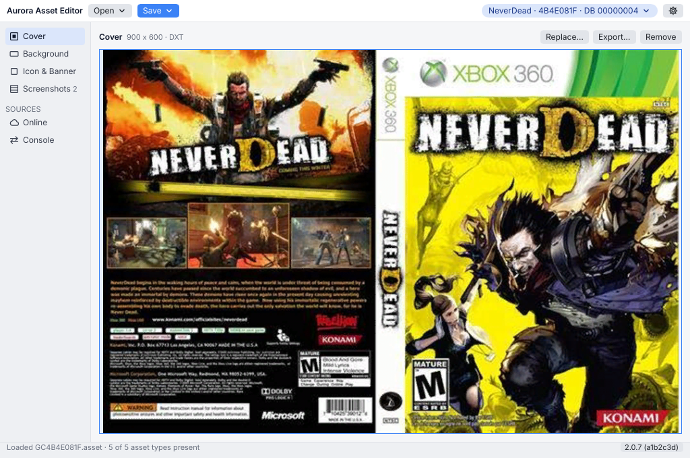
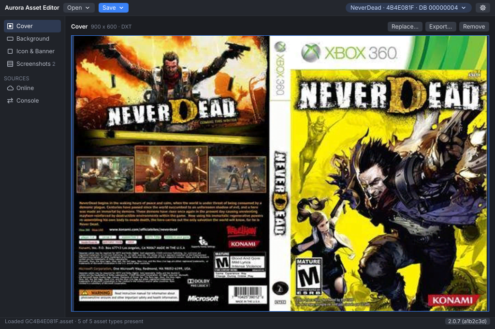
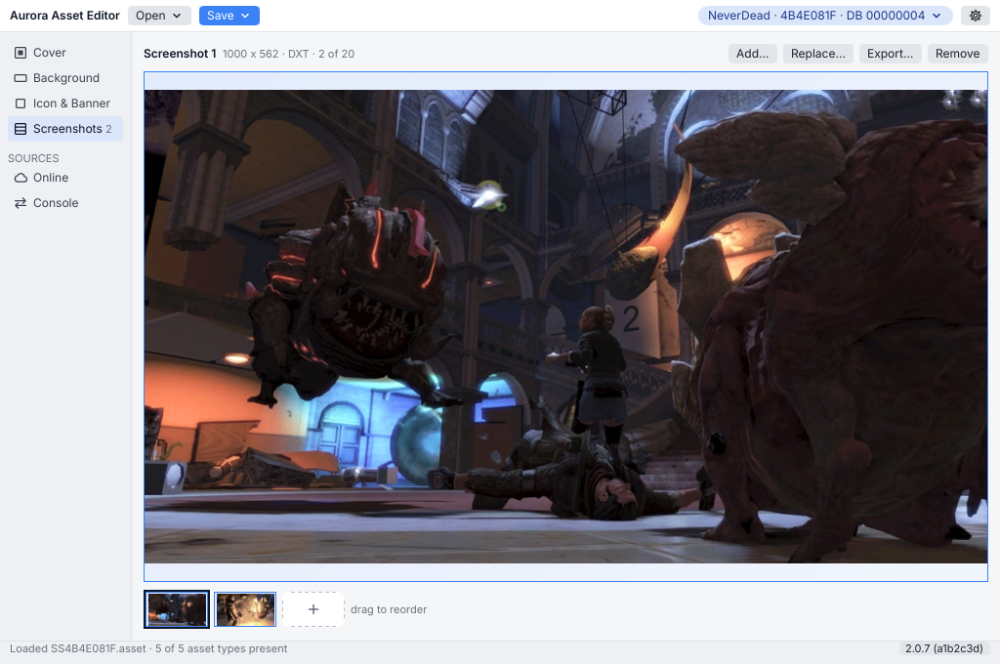
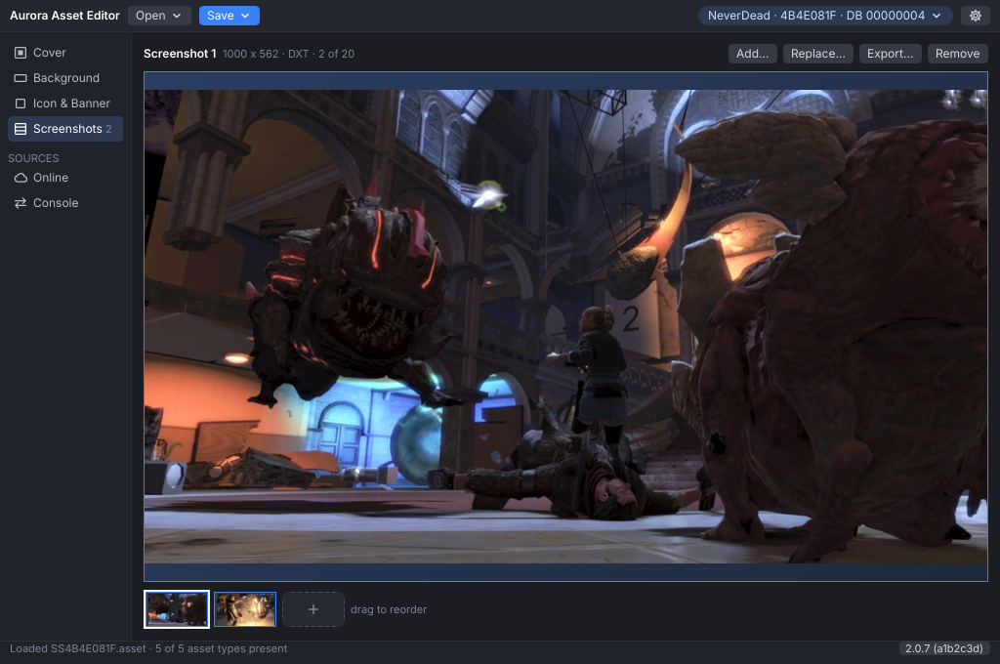
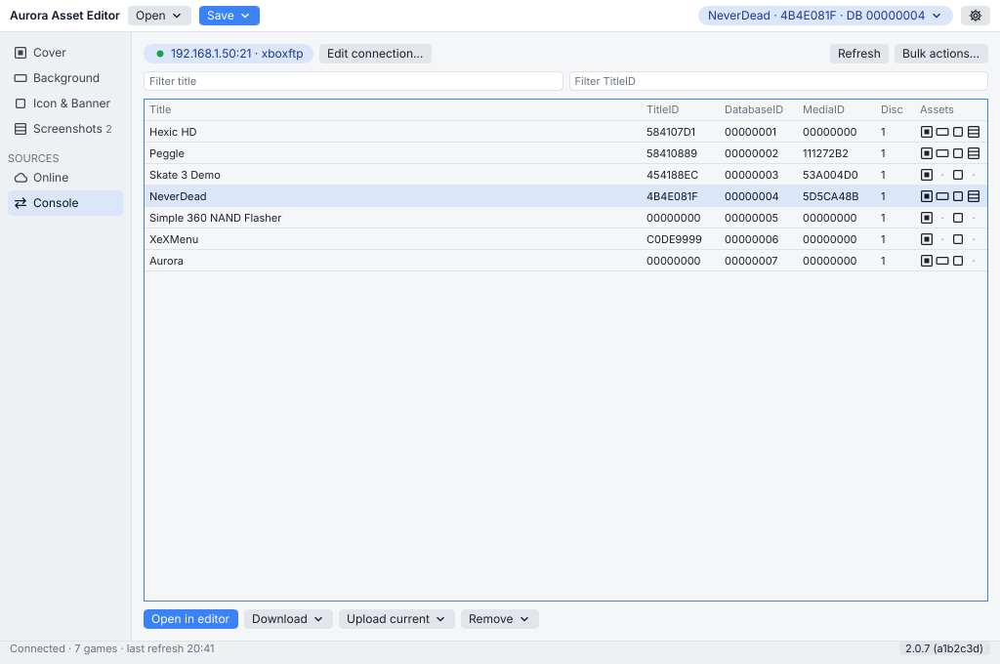
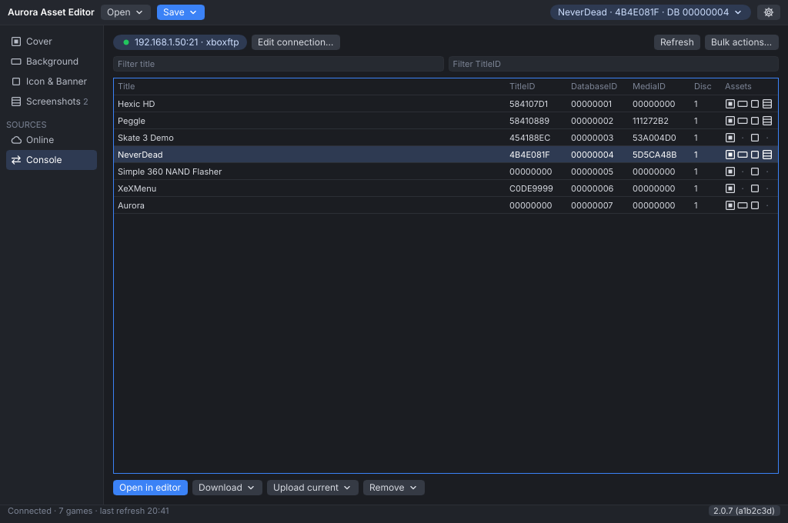
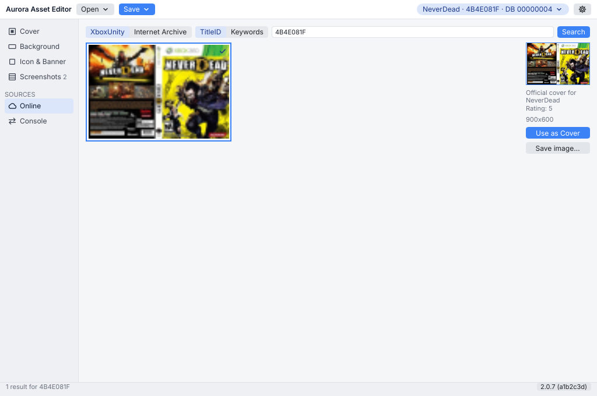
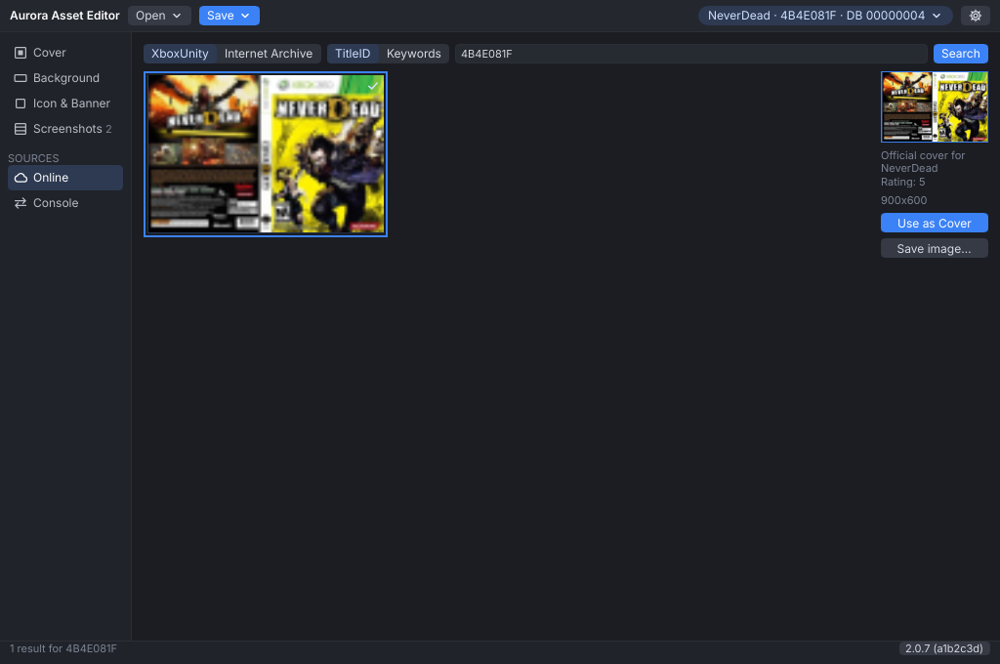

# Aurora Asset Editor

An editor for the art Aurora, the Xbox 360 dashboard, shows for each game: cover, background, icon, banner and screenshots. It opens and saves Aurora's `.asset` files, reads FSD `.assets` files, and works with the files on your console over FTP. Version 2 is a rewrite that runs on Windows, macOS and Linux.

## Screenshots

| | Light | Dark |
|---|---|---|
| Cover |  |  |
| Screenshots |  |  |
| Console |  |  |
| Online |  |  |

The game art in these screenshots comes from the maintainer's own console. They are refreshed with `cargo xtask readme-screenshots`.

## Download

Get the newest release from the [Releases page](https://github.com/XboxUnity/AuroraAssetEditor/releases).

| System | File | First run |
|---|---|---|
| Windows 10 and 11 (x64) | `AuroraAssetEditor-<version>-windows-x86_64.exe` | Windows may warn about an unknown publisher: choose More info, then Run anyway. |
| macOS 11 or later (Apple silicon and Intel) | `AuroraAssetEditor-<version>-macos-universal.dmg` | The app is not signed by Apple. Follow `First launch.txt` in the disk image. |
| Linux (x64 or arm64) | `AuroraAssetEditor-<version>-linux-<arch>.AppImage`, or the `.tar.gz` with the plain binary | Make the file executable (`chmod +x`). Needs glibc 2.35 or later, libwayland-client and fontconfig. Dragging files into the window does not work under Wayland; use Open. |

`SHA256SUMS.txt` on each release lists the checksums of every file.

## What it does

- Edit the cover, background, icon, banner and up to 20 screenshots of a game, from image files (PNG, JPEG, BMP, GIF, TIFF, WebP, TGA, ICO, QOI, DDS) or dropped onto the window.
- Save and open Aurora `.asset` files, one per asset type, exactly as Aurora expects them, compressed or not.
- Connect to Aurora's FTP server: list the console's games, open a game's assets, upload, download or remove them.
- Find covers on XboxUnity and the Internet Archive, and fetch a cover for every game on the console in one go.

## Building from source

Install [Rust](https://rustup.rs); the repository pins its toolchain in `rust-toolchain.toml`. On Linux, install `pkg-config`, `libwayland-dev`, `libfontconfig1-dev` and `libxkbcommon-dev` first.

    cargo build --release -p aurora-asset-editor
    cargo test --workspace

The checks against the original `AuroraAsset.dll` (`cargo xtask golden check`, `cargo xtask cross-decode`) run on Windows only.

## Credits

A Huge thanks goes out to MaesterRowen for explaining the format for me, and also for making the AuroraAsset.dll library which handles the image conversion (between D3DTexture and Bitmap)
Many thanks also goes to Mattie for the placeholder images :)

Thanks also goes to gavin_darkglider & felida for helping me test this thing :)

Thanks to RAP7HOR for the icon used in the application as of version 1.1!

Third-party code and fonts are listed with their licences in the app, under About.

## Licence

Public domain, see [UNLICENSE](UNLICENSE).
